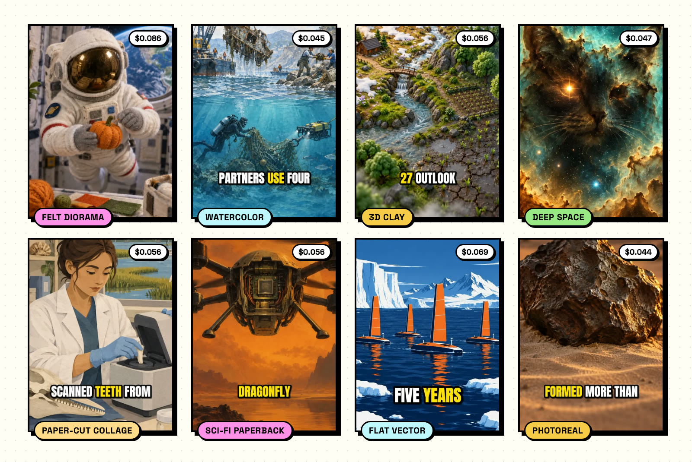
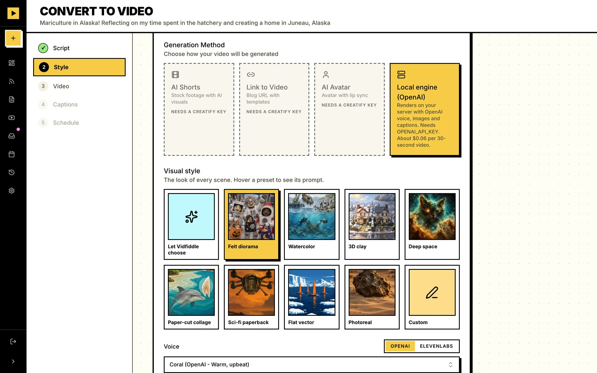
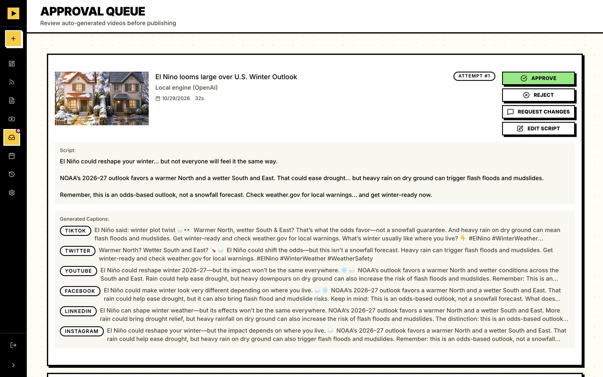
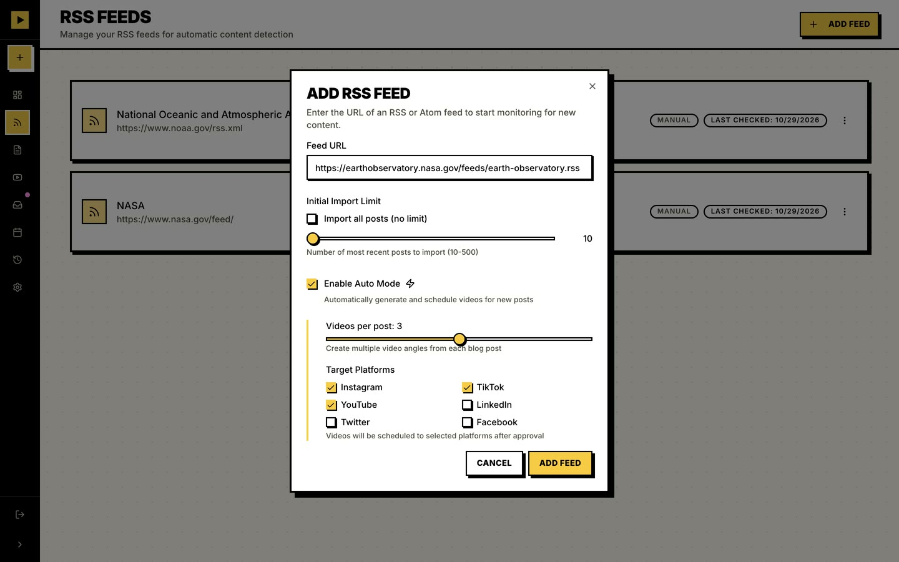
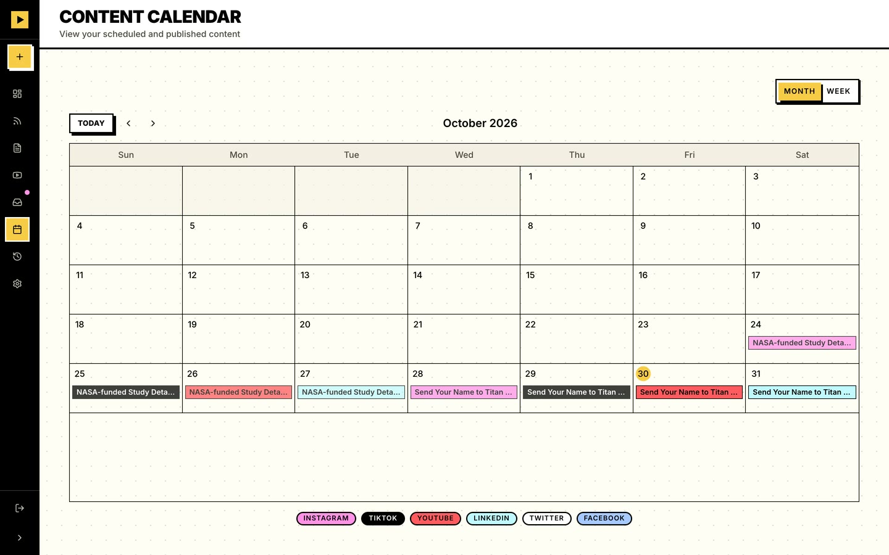

<!-- Launch video: edit this file on github.com and drag the launch MP4 here. GitHub turns it into an inline player. -->

<h1 align="center">Vidfiddle</h1>

<p align="center">
  <b>Your blog already wrote your next 100 videos.</b><br>
  Point Vidfiddle at an RSS feed. It writes a short script for each post, renders a vertical video on
  your own server for about six cents, and holds it for your OK before anything goes out.
</p>

<p align="center">
  <a href="https://github.com/zellerhaus/vidfiddle/actions/workflows/ci.yml"></a>
  <a href="LICENSE"></a>
  
</p>

<p align="center">
  <a href="#quick-start">Quick start</a> ·
  <a href="#what-the-videos-look-like">Examples</a> ·
  <a href="#what-it-costs">Costs</a> ·
  <a href="#faq">FAQ</a> ·
  <a href="CONTRIBUTING.md">Contributing</a>
</p>

---

Feed it an RSS feed, a URL or a YouTube link. It splits each post into a few video-sized ideas and writes
a 30–60 second script for each in your brand voice. Then it renders the videos, writes a caption per
platform, and queues everything for review. Nothing posts until you approve it.

```
RSS / URL / YouTube → segments → script → video → review queue → captions → scheduled posts
```

## What the videos look like

<p align="center">
  
</p>

Each of these came straight out of the local engine from a real NASA or NOAA post in a public RSS feed.
OpenAI wrote the script; the engine made the voice, the images and the captions. Nobody touched them
afterward. All eight cost $0.46 together, and each took 32 to 44 seconds to render.

| Style | Source post | Format | Length | Cost |
| --- | --- | --- | --- | --- |
| Felt diorama | [NASA: Halloween Aboard the International Space Station](https://www.nasa.gov/centers-and-facilities/johnson/halloween-aboard-the-international-space-station/) | 9:16 | 29s | $0.086 |
| Watercolor | [NOAA: 4 ways to clean up the big stuff](https://www.noaa.gov/stories/large-scale-marine-debris-4-ways-to-clean-up-big-stuff) | 9:16 | 30s | $0.045 |
| 3D clay | [NOAA: El Nino looms large over U.S. Winter Outlook](https://www.noaa.gov/news-release/el-nino-looms-large-over-us-winter-outlook) | 9:16 | 32s | $0.056 |
| Deep space | [NASA: Ghostly Cat’s Head Nebula](https://science.nasa.gov/missions/hubble/ghostly-cats-head-nebula-lurks-within-sight-of-nasas-hubble-webb/) | 16:9 | 35s | $0.047 |
| Paper-cut collage | [NOAA: A toothy summer in Charleston](https://www.noaa.gov/office-education/hollings-scholarship/stories/toothy-summer-in-charleston-my-internship-studying-barium-in-bottlenose-dolphin-teeth-to-determine) | 9:16 | 32s | $0.056 |
| Sci-fi paperback | [NASA: Send Your Name to Titan Aboard Dragonfly](https://www.nasa.gov/news-release/send-your-name-to-titan-aboard-nasas-dragonfly-mission/) | 9:16 | 30s | $0.056 |
| Flat vector | [NOAA: Saildrone fleet to circle Antarctica](https://www.noaa.gov/news/saildrone-research-fleet-to-circle-antarctica-for-5-years) | 1:1 | 36s | $0.069 |
| Photoreal | [NASA: One of Oldest Mars Meteorites Ever Found](https://www.nasa.gov/solar-system/planets/mars/nasa-funded-study-details-one-of-oldest-mars-meteorites-ever-found/) | 9:16 | 28s | $0.044 |

The MP4s are attached to the [v0.1.0 release](https://github.com/zellerhaus/vidfiddle/releases/tag/v0.1.0).
NASA and NOAA text is in the public domain; the images, voices and captions are AI-generated.

## The app

<table>
  <tr>
    <td width="50%"><br><sub><b>Pick a look and a voice.</b> Eight presets, your own prompt, or let it choose.</sub></td>
    <td width="50%"><br><sub><b>Approve, reject or ask for changes.</b> Script and per-platform captions side by side.</sub></td>
  </tr>
  <tr>
    <td width="50%"><br><sub><b>Auto Mode.</b> New posts become videos daily, and they still wait for review.</sub></td>
    <td width="50%"><br><sub><b>Calendar.</b> Everything scheduled, color-coded by platform.</sub></td>
  </tr>
</table>

## How it works

- **Scripts and captions** come from OpenAI or Anthropic (`LLM_PROVIDER`).
- **Videos** come from one of two engines:
  - **Local engine (OpenAI):** renders on your server. `gpt-4o-mini-tts` (or an ElevenLabs voice) reads the script, `gpt-image`
    draws a still for each scene, `whisper-1` times every word, and ffmpeg cuts each still into shots
    with camera moves, burns in word-by-word captions, and mixes music under the voice. About
    **$0.06 for a 30-second video**, billed to your OpenAI account.
    - **Visual style:** pick one of eight looks from the showcase (felt diorama, watercolor, 3D
      clay, deep space, paper-cut collage, sci-fi paperback, flat vector, photoreal), describe your
      own, or let the planner choose one that fits the post.
    - **Pacing:** slow (a new picture about every 8 seconds), medium (a new shot about every 4) or
      fast (every 2–3). Same cost at every pace.
    - **Voice:** any of OpenAI's voices, or any voice in your ElevenLabs account when
      `ELEVENLABS_API_KEY` is set (billed in ElevenLabs credits, about one per character). Each scene
      is read with its neighbors as context, so the delivery flows across scenes.
    - **Music:** matched to the script's mood, from the starter tracks in `assets/music` plus any
      you drop into `music/` ([how](music/README.md)). Set `ELEVENLABS_API_KEY` to compose a fresh
      track per video instead. Narration is leveled to -14 LUFS, the loudness social apps expect.
  - **[Creatify](https://creatify.ai):** hosted stock-footage and AI-avatar videos (paid, optional).
- **Publishing** goes through [Publer](https://publer.com) (hosted, paid) or
  [LightPost](https://github.com/brainstormity/LightPost) (self-hosted, free).
- **YouTube clips:** finds the most shareable moments in a long video and cuts captioned clips
  (optional; uses Deepgram plus Creatomate or Submagic).

Auto mode runs the whole pipeline on new feed posts daily. To catch up on a backlog, select posts on
**Content** and create a video from each at once. Either way, videos wait in the review queue for
approval.

## What it costs

Vidfiddle is free. You pay the APIs you plug in, on your own accounts.

| Piece | What you pay |
| --- | --- |
| Local engine video (OpenAI) | About $0.06 per 30 seconds. The showcase ranged from $0.044 to $0.086. |
| Scripts and captions | Your OpenAI or Anthropic usage: one script and one set of captions per video |
| ElevenLabs voice or music (optional) | ElevenLabs credits, about one per character of narration |
| Creatify (optional) | Your Creatify plan |
| Publishing | Your Publer plan, or nothing with self-hosted LightPost |
| Server | Any machine that runs Docker. No GPU: images come from the API and ffmpeg runs on the CPU. |

## Quick start

Requirements: Docker with Compose, and an OpenAI API key.

```bash
git clone https://github.com/zellerhaus/vidfiddle.git
cd vidfiddle
cp .env.example .env    # set APP_PASSWORD, CRON_SECRET, WORKER_SECRET and OPENAI_API_KEY
docker compose up -d
```

Open http://localhost:3000 and sign in with `APP_PASSWORD`. Add a feed under **Feeds**, pick a post under
**Content**, and convert it. Choose **Local engine (OpenAI)** in the style step.

The first build takes a few minutes. Compose starts three services:

| Service    | What it does                                                                |
| ---------- | --------------------------------------------------------------------------- |
| `app`      | The web app (Next.js) on port 3000                                          |
| `worker`   | Runs migrations, scheduled jobs, local-engine renders and YouTube downloads |
| `postgres` | The database                                                                |

Videos and images live in the `media` volume. Back up both volumes, `postgres` and `media`.

## Configuration

Everything is set in `.env`. [`.env.example`](.env.example) documents each setting. The ones that matter
most:

| Setting                                  | Purpose                                                                 |
| ---------------------------------------- | ----------------------------------------------------------------------- |
| `APP_PASSWORD`                           | The single login. This is a one-person app.                             |
| `CRON_SECRET`, `WORKER_SECRET`           | Shared secrets between the app and the worker. Any long random strings. |
| `OPENAI_API_KEY`                         | Scripts, captions and the local video engine.                           |
| `ANTHROPIC_API_KEY`, `LLM_PROVIDER`      | Use Claude for scripts and captions instead.                            |
| `PUBLIC_URL`                             | The app's public address. See below.                                    |
| `APP_PORT`                               | The host port for the web app (default 3000).                           |
| `STORAGE_DRIVER`, `S3_*`                 | Keep media on local disk (default) or in an S3-compatible bucket.       |
| `PUBLER_*` or `PUBLISHER`, `LIGHTPOST_*` | Where scheduled posts go.                                               |
| `CREATIFY_*`                             | The hosted Creatify engine, if you want it.                             |
| `ELEVENLABS_API_KEY`                     | ElevenLabs voices for narration, and music composed per video.          |
| `MUSIC_DIR`, `MUSIC_PROVIDER`            | Your own music folder; `library` keeps it even with an ElevenLabs key.  |
| `CRON_<JOB>`                             | Change a job's schedule (5-field cron), or turn it `off`.               |

### Media must be reachable for publishing

Instagram, Facebook, Threads, Publer and LightPost all fetch your video **by URL**. If you schedule
posts, either:

- set `PUBLIC_URL` to an address the internet can reach (a domain behind a reverse proxy, or a tunnel
  such as Cloudflare Tunnel), or
- use `STORAGE_DRIVER=s3` with a public bucket (Cloudflare R2, Backblaze B2, AWS S3) and `S3_PUBLIC_URL`.

Rendering and reviewing work fine on a private network; only publishing needs this.

### Publishing with LightPost

LightPost is a small self-hosted scheduler. Video support for Instagram Reels, Facebook Pages, Threads
and LinkedIn is in progress upstream. Set `PUBLISHER=lightpost`, `LIGHTPOST_URL` and
`LIGHTPOST_PASSWORD`, and connect your accounts in LightPost. To pick specific accounts, set
`LIGHTPOST_ACCOUNTS=instagram=<id>,linkedin=<id>`; otherwise every connected account for a platform is
used.

## Running without Docker

You need Node.js 22+, PostgreSQL 15+, and an ffmpeg built with libass (for burned-in captions; Debian
and Ubuntu packages include it, and on macOS use `brew install ffmpeg-full`). yt-dlp is needed only for
YouTube clips.

```bash
npm ci
cp .env.example .env    # also set DATABASE_URL, WORKER_URL and APP_INTERNAL_URL
npm run migrate
npm run build && npm start    # the web app
npm run worker                # in another terminal
```

To try the engine on its own, render any script to MP4 without the app or a database:

```bash
OPENAI_API_KEY=... npx tsx scripts/render-video.ts --script post.txt --out video.mp4 --aspect 9x16
```

## FAQ

**How is this different from MoneyPrinterTurbo or ShortGPT?**
Those start from a topic and fill the screen with stock footage. Vidfiddle starts from posts you already
wrote, draws every scene in one consistent style, holds each video for review, and schedules the result.
It's built for someone with a blog and a backlog, more than for a faceless channel.

**Won't this flood my feeds with AI slop?**
Only if you approve slop. The words come from your own post, and every video waits in the queue: you can
edit the script, ask for changes or reject it. Auto Mode never posts by itself.

**Which platforms can it post to?**
Through Publer: Instagram, TikTok, YouTube, LinkedIn, X and Facebook. Through LightPost, whatever your
LightPost install supports. You can also just download the MP4s.

**Can I use Claude instead of GPT for the writing?**
Yes. Set `ANTHROPIC_API_KEY` and `LLM_PROVIDER=anthropic`. The local engine still needs an OpenAI key: it plans
the scenes, draws the images, times the words and (unless you pick ElevenLabs) reads the script.

**Can more than one person log in?**
Not yet. It's a single-password, one-person app.

## Development

```bash
npm run dev            # web app with hot reload
npm run worker         # worker
npm test               # unit tests
npm run lint
npx tsc --noEmit
```

- The database schema lives in [`src/db/schema.ts`](src/db/schema.ts). After changing it, run
  `npm run db:generate` to write a migration to `drizzle/`. `npm run migrate` (and the worker, at
  startup) applies it.
- One test writes to a real database. Point `TEST_DATABASE_URL` at a disposable Postgres to run it;
  otherwise it is skipped.
- The local engine is in [`src/lib/video-engine/`](src/lib/video-engine). Each stage (scene planning,
  voice, images, word timing) is a small interface, so adding a provider such as ElevenLabs voices or
  Pexels footage means writing one class.

Pull requests are welcome. [CONTRIBUTING.md](CONTRIBUTING.md) covers setup, style and where help is most
useful. Running an older Vercel and Supabase install? See
[Moving from the original hosted setup](docs/migrating-from-hosted.md).

## Who's behind it

Vidfiddle is made by Preston Zeller at [Zellerhaus](https://zellerhaus.com). Updates go out on
[X](https://x.com/prestonzeller) and [LinkedIn](https://www.linkedin.com/in/prestonzeller). If you want a
content pipeline like this built or tuned for your team, [get in touch](https://zellerhaus.com).

If Vidfiddle saves you an afternoon, a star helps other people find it.

## License

[MIT](LICENSE). The bundled caption font, Anton, is under the [SIL Open Font License](assets/fonts/OFL.txt).
The starter music in `assets/music` is CC0; see [its README](assets/music/README.md) for credits.
